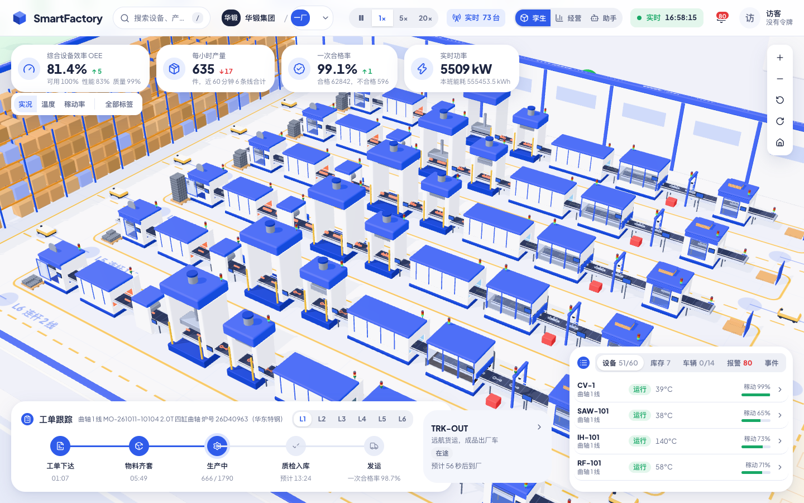
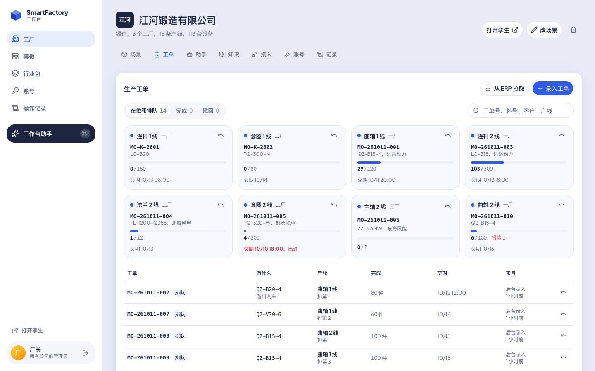
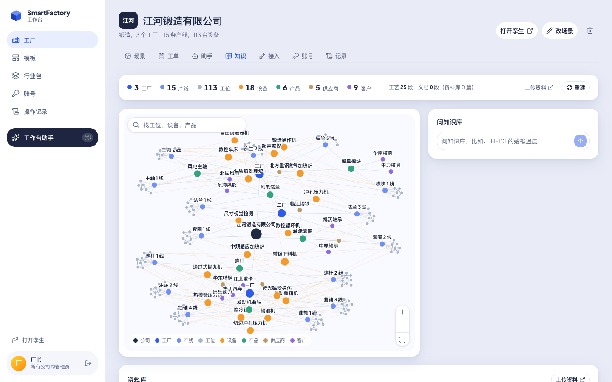
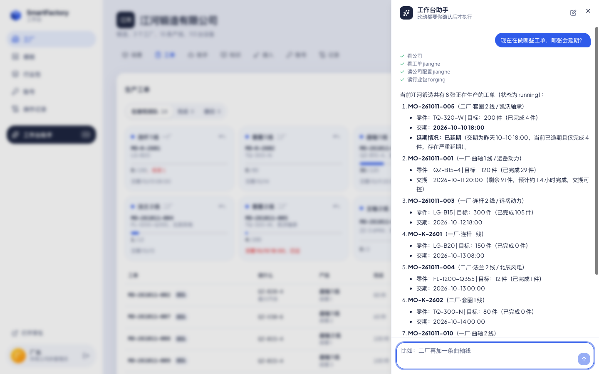

# SmartFactory

English | [中文](README_CN.md)

A smart factory a company runs on its own server: an admin console, a live 3D twin and AI assistants in one program.



| Production orders (ERP) | Knowledge graph | Console assistant |
|---|---|---|
|  |  |  |

## Features

### Build the factory
- Start from a built-in template (forging, EV batteries, food and beverage, machining, air conditioners, automotive, central kitchen and restaurants, campsite), describe the plant to the AI in a sentence, or write the config yourself.
- Plant breakdown: company › plant › area › line › machine, with floor plans drawn as you type. Edit one part with a form or by asking the AI.
- Industry packs hold a kind of site's products, machines and routes. The AI can write a new pack and draw a machine's or product's 3D shape.
- One company per server, or several.

### Live 3D twin
- Every line and machine runs in the browser, on a desktop or a phone, simulated or fed by real equipment, and everyone watching sees the same plant.
- Click a machine for its readings, state and output.
- Business view: the plant's figures, an advisor agent that looks for problems and proposes plans, and what-if runs of a plan on a copy of the plant.

### Production
- Orders: production orders from the ERP (pushed to the order API or pulled from it), the line each runs on, and progress.
- Planning: a Gantt chart by line, why an order is late, re-planning for a goal, moving orders by hand, and what-if for a rush order.
- Checks: patrol rounds, first-article checks and lab results filled in on a phone at the machine (from the code printed on it, offline too). Readings outside their limits are flagged on the spot, and overdue rounds are listed.
- Commands: rules every command to a machine must pass, how far the AI may act alone, and AI commands waiting for an operator.

### Materials and R&D
- BOM: multi-level, in revisions, with a kit check for a quantity that flags shortages.
- Stores: stock by heat or batch, receipts, issues, counts, safety stock, tracing, and purchase lines that give the plan its material arrival times.
- Dies: each die's press, strokes against its design life, re-sinking and scrapping.
- R&D: new part development, from drawing and die revisions through trial forgings and inspection to sign-off.

### Data
- Connect: an embedded MQTT broker with a token or certificate per device, Modbus, OPC UA and MQTT sources, an edge gateway (`smartfactory edge`), a device emulator (`smartfactory devices`), ERP connections, and an optional PostgreSQL history database.
- Anomalies: learns each machine's normal readings and gives a hint when one stays off.
- Calibration: fits each machine's simulation to what it measured.
- Value: what the twin and its AI did for the company over a period.
- Restaurants: table status from a camera box, the POS or a waiter's phone (`/waiter`).

### AI
Works with any OpenAI-compatible model. Without one, the assistants are off and everything else works, the knowledge base included.
- Console assistant beside every page. It proposes changes as cards and carries them out only when confirmed.
- Company assistants to talk to from the twin.
- Knowledge base (CortexDB): the process as a graph, orders, machine events and your documents (PDF, Word, Excel, text), searchable in plain language with sources. Administrators can open it as a live 3D graph that lights up what the assistant reads.
- Ontology: classes, relations, rules and constraints for each industry, with inference.

### Administration
- Accounts with sign-in (on by default) and roles: administrator, operator, inspector, member. Tokens for devices, the ERP and AI agents.
- Audit log of who changed what, and server health (CPU, memory, disk, simulation cost, connections).

## Install

Linux (systemd), from [Releases](https://github.com/liliang-cn/smartfactory/releases):

```sh
tar xzf smartfactory-*-linux-amd64.tar.gz
cd smartfactory-*-linux-amd64
sudo ./smartfactory install
```

Open `http://<server>:4720/admin` and create the administrator account. Opened from another machine, the page asks for the installation code: `sudo cat /var/lib/smartfactory/initial-admin-token`.

| | |
|---|---|
| Upgrade | Run `sudo ./smartfactory install` from the new version |
| Uninstall | `sudo smartfactory uninstall`; add `-purge` to delete the data too |
| Logs | `journalctl -u smartfactory -f` |

macOS and Windows: `smartfactory -config smartfactory.json`. Without a config, data goes to `./data`.

## Configure

| Where | |
|---|---|
| `/etc/smartfactory/smartfactory.json` | `http` listen address, `mqtt.users` device accounts, `sources` Modbus / OPC UA / MQTT |
| `/etc/smartfactory/env` | `LLM_BASE_URL`, `LLM_API_KEY`, `LLM_MODEL` (OpenAI-compatible), `HTTPS_PROXY`; optionally `CORTEXDB_EMBED_BASE_URL`, `CORTEXDB_EMBED_MODEL`, `CORTEXDB_EMBED_DIM` (an embedding model, so documents are found by meaning) |
| `/var/lib/smartfactory` | All the data. Back this up. |

After a change: `sudo systemctl restart smartfactory`.

- Devices: MQTT topic `sf/{company}/{plant}/{asset}/{field}`, see [protocol/devices.md](protocol/devices.md)
- ERP: the console's Connect page; the API is in [protocol/README.md](protocol/README.md)
- HTTPS: put a reverse proxy in front, e.g. Caddy `reverse_proxy 127.0.0.1:4720`

## AI agents

Give the agent a token in the console's Accounts page.

MCP:

```sh
claude mcp add --transport http smartfactory http://<server>:4720/mcp --header "Authorization: Bearer <token>"
```

Command line (`-json` for JSON output):

```sh
export SF_SERVER=http://<server>:4720 SF_TOKEN=<token>
smartfactory company -json
smartfactory orders <company> -json
smartfactory orders <company> send -f orders.json
smartfactory kb <company> search "question" -json
```

## Build

Node.js 22+ and Go 1.27+:

```sh
(cd web && npm ci)
scripts/build.sh      # server/bin/smartfactory
scripts/release.sh    # release packages for each platform
```

## License

[AGPL-3.0](LICENSE)
