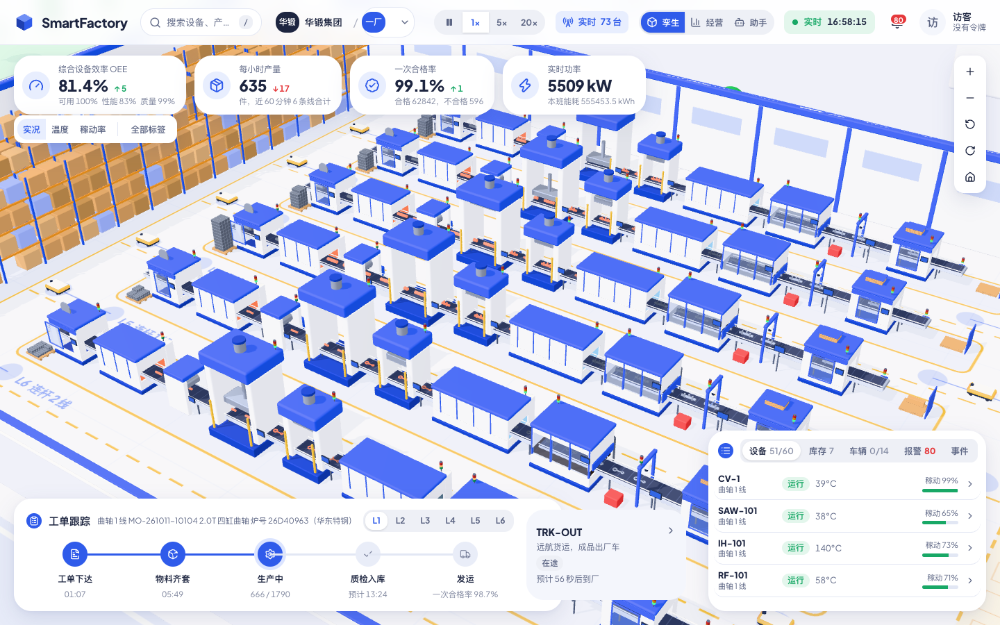
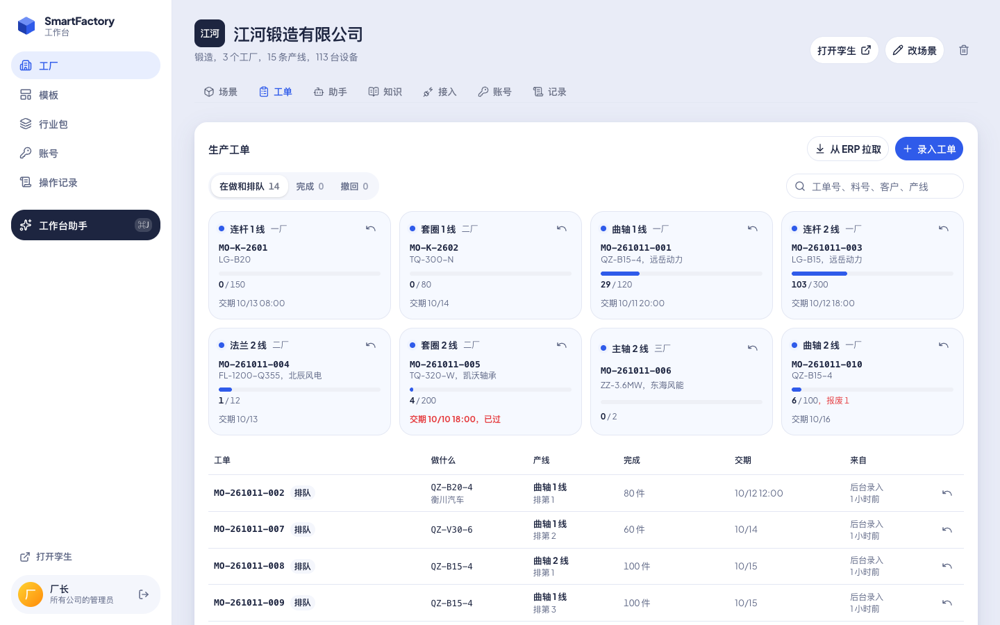
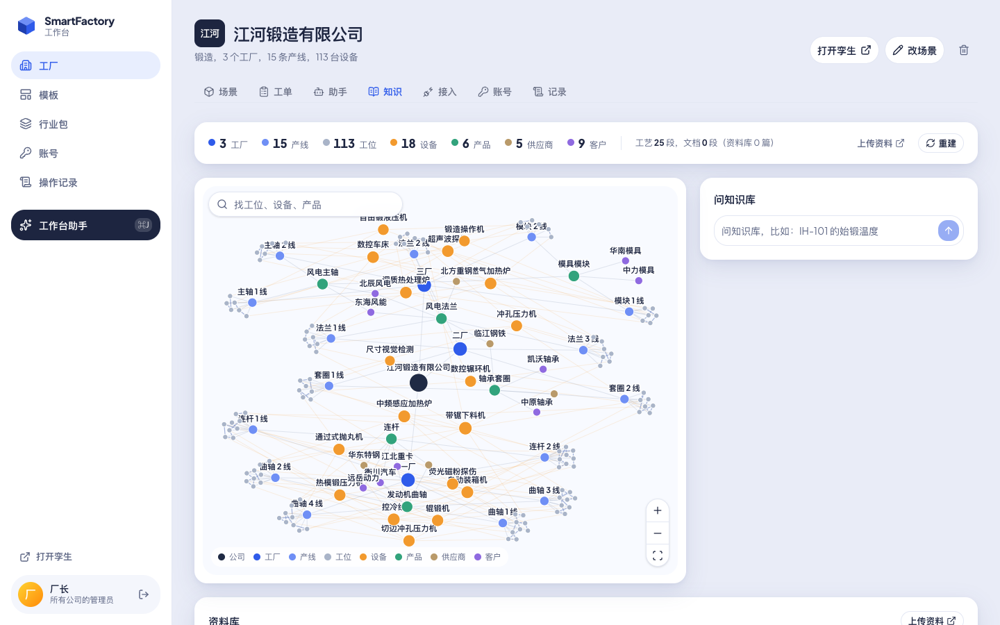
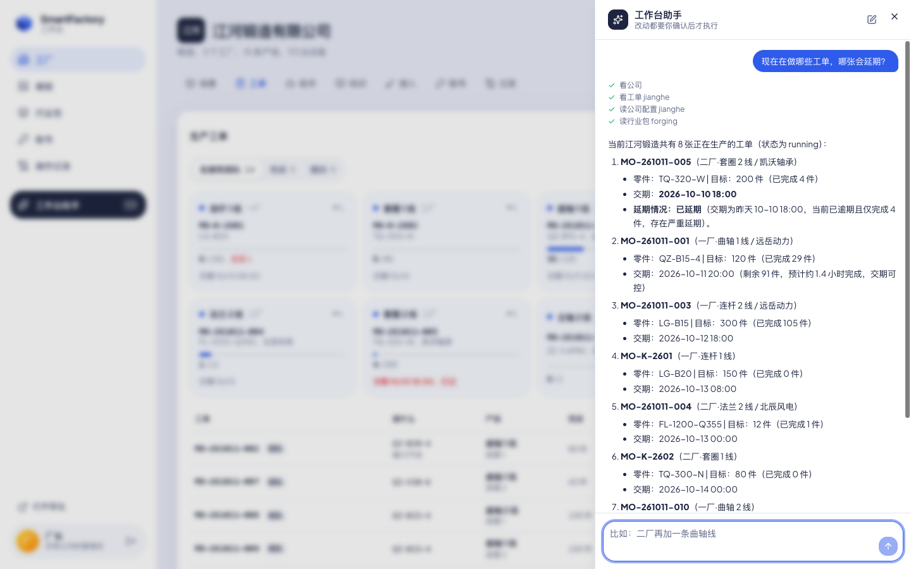

# SmartFactory

一家公司自己部署的智能工厂：后台、实时 3D 孪生、AI 助手。



| 生产工单（ERP） | 知识图谱 | 工作台助手 |
|---|---|---|
|  |  |  |

## 安装

Linux（systemd），从 [Releases](https://github.com/liliang-cn/smartfactory/releases) 下载：

```sh
tar xzf smartfactory-v0.1.0-linux-amd64.tar.gz
cd smartfactory-v0.1.0-linux-amd64
sudo ./smartfactory install
```

打开 `http://<服务器>:4720/admin`，管理员令牌：`sudo cat /var/lib/smartfactory/initial-admin-token`。

| | |
|---|---|
| 升级 | 新版本再执行 `sudo ./smartfactory install` |
| 卸载 | `sudo smartfactory uninstall`，加 `-purge` 连数据一起删 |
| 日志 | `journalctl -u smartfactory -f` |

macOS、Windows：`smartfactory -config smartfactory.json`，不带配置时数据在 `./data`。

## 配置

| 位置 | |
|---|---|
| `/etc/smartfactory/smartfactory.json` | `http` 监听地址，`mqtt.users` 设备账号，`sources` Modbus / OPC UA / MQTT 数据源 |
| `/etc/smartfactory/env` | `LLM_BASE_URL`、`LLM_API_KEY`、`LLM_MODEL`（OpenAI 兼容接口），`HTTPS_PROXY` |
| `/var/lib/smartfactory` | 全部数据，备份它 |

改完 `sudo systemctl restart smartfactory`。

- 设备：MQTT 主题 `sf/{公司}/{工厂}/{设备}/{字段}`，见 [protocol/devices.md](protocol/devices.md)
- ERP：后台「接入」，接口见 [protocol/README.md](protocol/README.md)
- HTTPS：前面放反向代理，比如 Caddy `reverse_proxy 127.0.0.1:4720`

## AI Agent

安装同上。在后台「账号」里给 agent 发一个令牌。

MCP：

```sh
claude mcp add --transport http smartfactory http://<服务器>:4720/mcp --header "Authorization: Bearer <令牌>"
```

命令行（`-json` 输出 JSON）：

```sh
export SF_SERVER=http://<服务器>:4720 SF_TOKEN=<令牌>
smartfactory company -json
smartfactory orders <公司> -json
smartfactory orders <公司> send -f orders.json
smartfactory kb <公司> search "问题" -json
```

## 构建

Node.js 22+、Go 1.27+：

```sh
npm ci
scripts/build.sh      # server/bin/smartfactory
scripts/release.sh    # 各平台发布包
```

## License

[AGPL-3.0](LICENSE)
