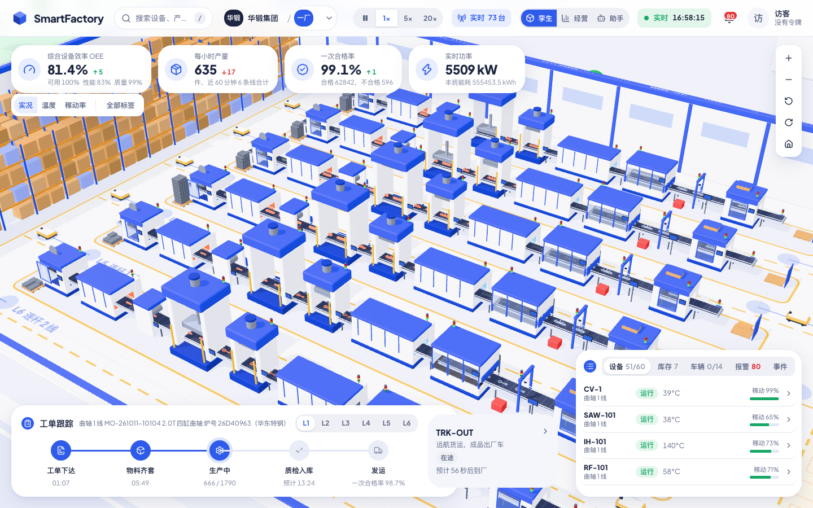
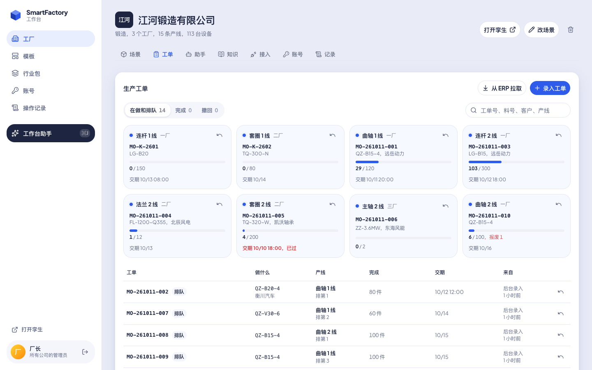
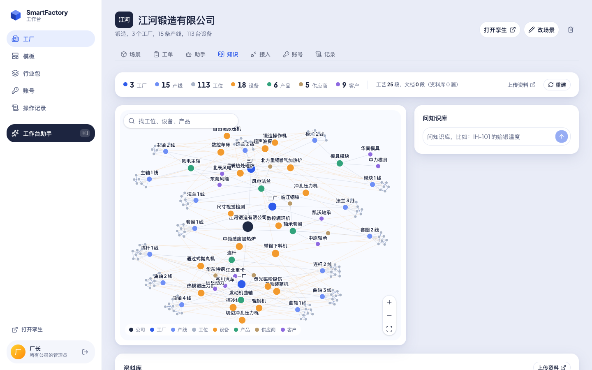
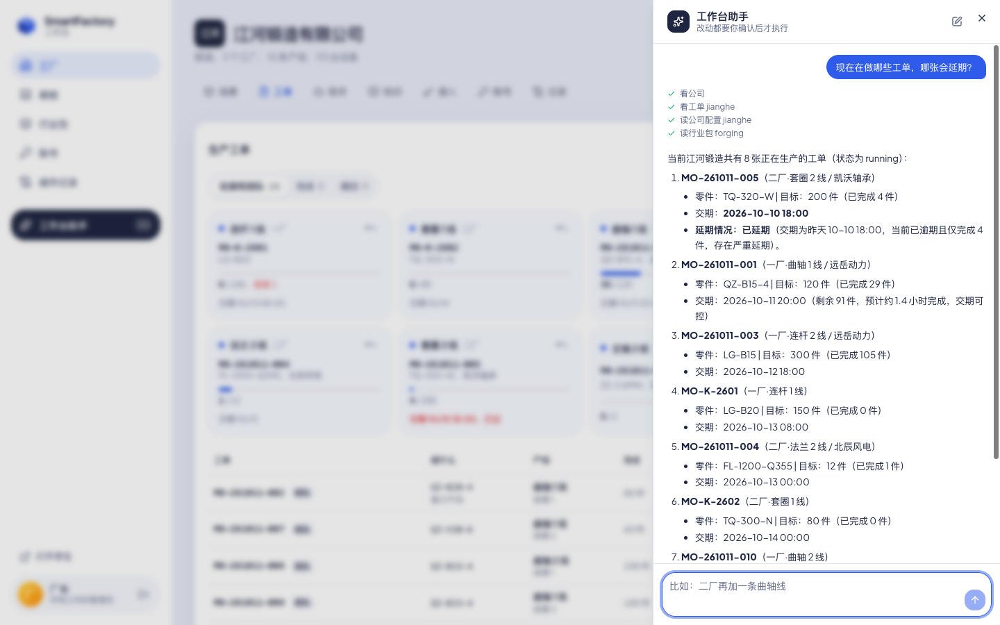

# SmartFactory

[English](README.md) | 中文

一家公司装在自己服务器上的智能工厂：后台、实时 3D 孪生、AI 助手，一个程序。



| 生产工单（ERP） | 知识图谱 | 工作台助手 |
|---|---|---|
|  |  |  |

## 功能

### 建厂
- 从内置模板起步（锻造、动力电池、食品饮料、机加工、空调、汽车、中央厨房和门店、露营地），或者用一句话描述给 AI，或者自己写配置。
- 工厂结构：公司 › 工厂 › 车间 › 产线 › 设备，边填边画平面图；选中某一处，用表单改或者让 AI 改。
- 行业包：一类工厂的产品、设备和工艺路线。AI 能写新的行业包，也能画设备和产品的 3D 外形。
- 一台服务器可以只放一家公司，也可以放多家。

### 实时 3D 孪生
- 每条产线、每台设备都在浏览器里运转，电脑和手机都能看；可以是仿真，也可以接真实设备，所有人看到的是同一座工厂。
- 点设备看读数、状态和产量。
- 经营视图：工厂的经营数据；顾问助手找问题、出方案；方案先在工厂的副本上推演。

### 生产
- 工单：ERP 推过来或者从 ERP 拉过来的生产工单，排在哪条线、做到哪了。
- 生产计划：按产线的甘特图，工单为什么会晚，按目标重排，手动挪动，急单推演。
- 点检：巡检、首件、化验，在设备旁用手机填（扫设备上贴的码，没网也能填）；读数超标当场标出，逾期的点检列出来。
- 指令：发给设备的每条指令都要过的规则，AI 能自己做到哪一步，等操作员确认的 AI 指令。

### 物料与研发
- BOM：多层、分版本，按数量算齐套，缺料标出来。
- 库房：按炉号或批次管库存，入库、出库、盘点、安全库存、追溯；采购单给生产计划提供到料时间。
- 模具：每副模具在哪台压力机上，打了多少次、离设计寿命还有多少，返修、报废。
- 研发：新零件开发，从图纸和模具改版、试锻、检验到签收。

### 数据
- 接入：内置 MQTT broker，每台设备一个令牌或证书；Modbus、OPC UA、MQTT 数据源；边缘网关（`smartfactory edge`）；设备模拟器（`smartfactory devices`）；ERP 对接；可选的 PostgreSQL 历史库。
- 读数异常：学会每台设备的正常读数，读数一直偏离时给出提示。
- 校准：按设备实测数据拟合它的仿真参数。
- 成效：一段时间里孪生和 AI 给公司做了什么。
- 餐饮：桌态来自摄像头盒子、收银系统或服务员手机（`/waiter`）。

### AI
接任何 OpenAI 兼容的大模型。不配模型时助手不可用，其他功能照常，知识库也能用。
- 工作台助手：每个页面旁边都能问；它提的改动是一张卡片，确认后才执行。
- 公司自己的助手，在孪生里对话。能看设备现在的状态，也能按设备传来的数据查过去几小时到几周的情况：读数怎么变、停了几次、为什么停、哪台停得最久。外部 AI 通过 MCP 也能查。
- 知识库（CortexDB）：工艺图谱、工单、设备记录和你的文档（PDF、Word、Excel、文本），用大白话问，回答带出处。管理员可以用 3D 图谱看它，助手查了什么，图上就亮什么。
- 本体：每个行业的类、关系、规则和约束，带推理。

### 管理
- 账号登录（默认必须登录），角色有管理员、操作员、质检员、成员；设备、ERP 和 AI agent 用令牌。
- 操作记录（谁改了什么），运行状况（CPU、内存、磁盘、仿真开销、连接）。

## 安装

Linux（systemd），从 [Releases](https://github.com/liliang-cn/smartfactory/releases) 下载：

```sh
tar xzf smartfactory-*-linux-amd64.tar.gz
cd smartfactory-*-linux-amd64
sudo ./smartfactory install
```

打开 `http://<服务器>:4720/admin`，建管理员账号。不是在服务器本机打开时，页面会要安装码：`sudo cat /var/lib/smartfactory/initial-admin-token`。

| | |
|---|---|
| 升级 | 新版本再执行 `sudo ./smartfactory install` |
| 卸载 | `sudo smartfactory uninstall`，加 `-purge` 连数据一起删 |
| 日志 | `journalctl -u smartfactory -f` |

macOS、Windows：`smartfactory -config smartfactory.json`，不带配置时数据在 `./data`。

## 配置

| 位置 | |
|---|---|
| `/etc/smartfactory/smartfactory.json` | `http` 监听地址，`mqtt.users` 设备账号，`sources` Modbus / OPC UA / MQTT 数据源 |
| `/etc/smartfactory/env` | `LLM_BASE_URL`、`LLM_API_KEY`、`LLM_MODEL`（OpenAI 兼容接口），`HTTPS_PROXY`；可选 `CORTEXDB_EMBED_BASE_URL`、`CORTEXDB_EMBED_MODEL`、`CORTEXDB_EMBED_DIM`（向量模型，资料按意思检索） |
| `/var/lib/smartfactory` | 全部数据，备份它 |

改完 `sudo systemctl restart smartfactory`。

- 设备：MQTT 主题 `sf/{公司}/{工厂}/{设备}/{字段}`，见 [protocol/devices.md](protocol/devices.md)
- ERP：后台「接入」，接口见 [protocol/README.md](protocol/README.md)
- HTTPS：前面放反向代理，比如 Caddy `reverse_proxy 127.0.0.1:4720`

## AI Agent

在后台「账号」里给 agent 发一个令牌。

MCP：

```sh
claude mcp add --transport http smartfactory http://<服务器>:4720/mcp --header "Authorization: Bearer <令牌>"
```

命令行（`-json` 输出 JSON）：

```sh
export SF_SERVER=http://<服务器>:4720 SF_TOKEN=<令牌>
smartfactory company -json
smartfactory orders <公司> -json
smartfactory orders <公司> send -f orders.json
smartfactory kb <公司> search "问题" -json
```

## 构建

Node.js 22+、Go 1.27+：

```sh
(cd web && npm ci)
scripts/build.sh      # server/bin/smartfactory
scripts/release.sh    # 各平台发布包
```

## License

[AGPL-3.0](LICENSE)
